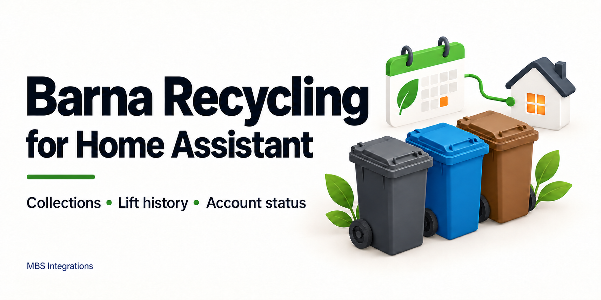
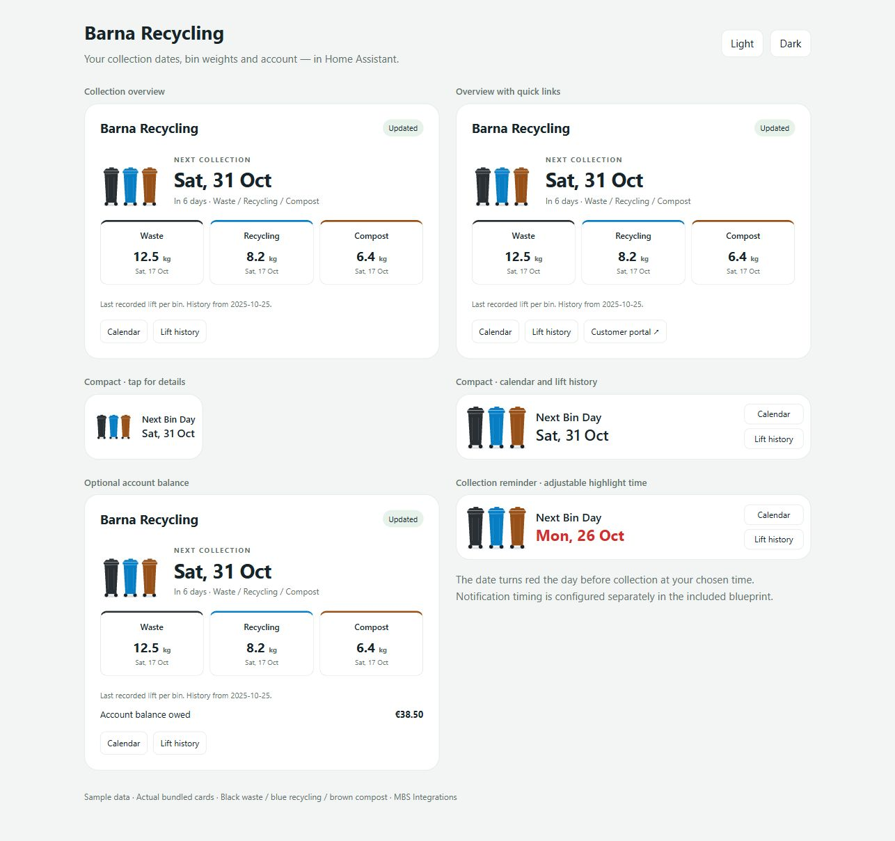
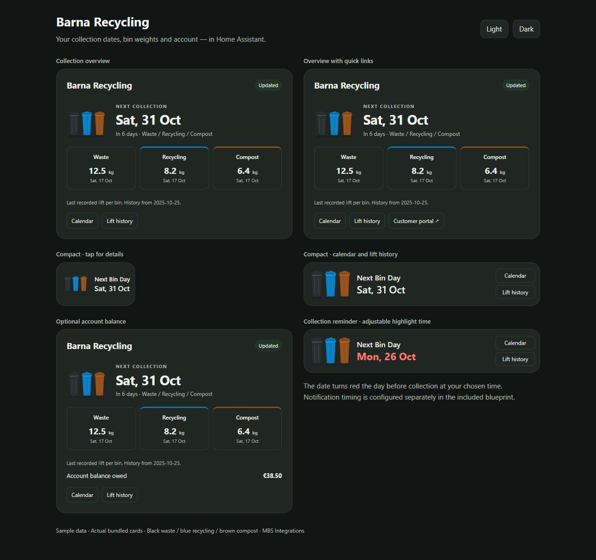
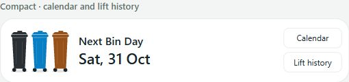
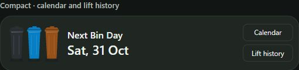
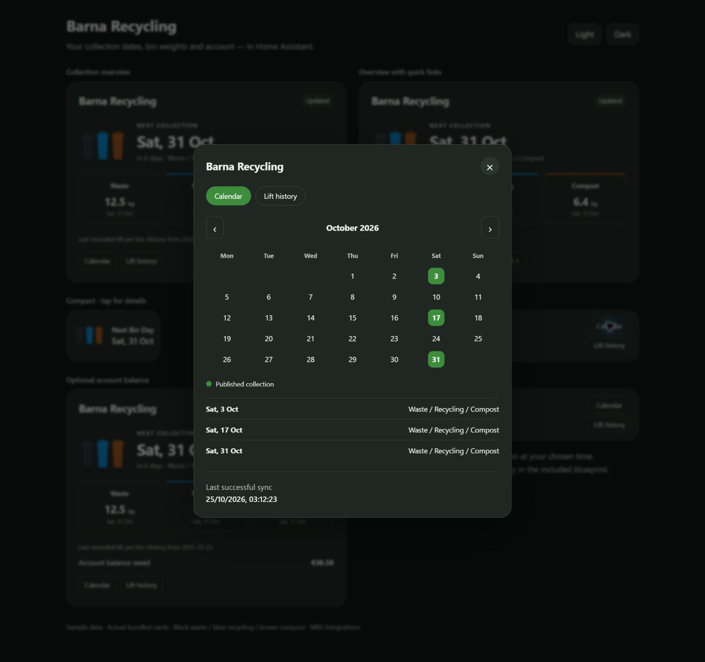
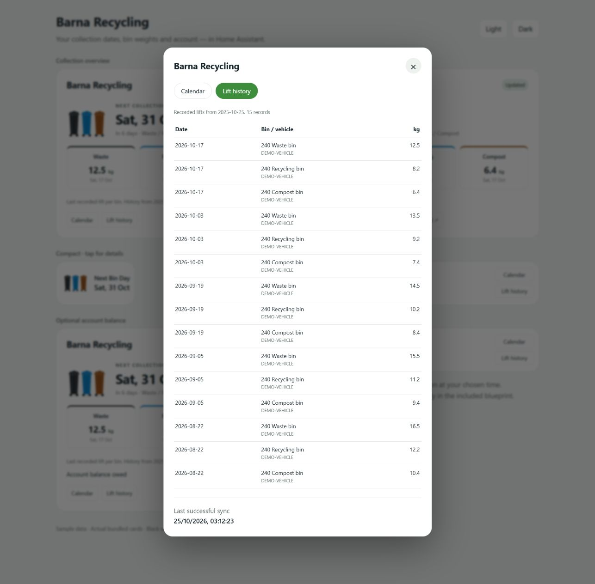
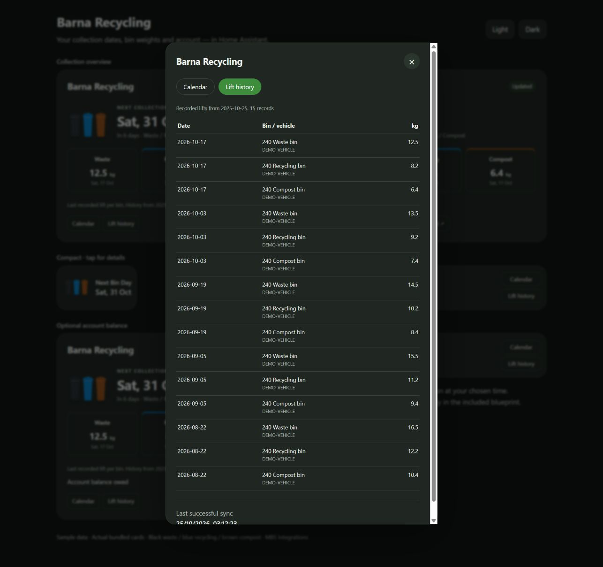

# Barna Recycling for Home Assistant

Bring your Barna collection calendar, recorded bin weights and account balance into Home Assistant. Includes four ready-made cards, calendar and lift-history popups, and a collection reminder blueprint.

## Features

- **Published dates:** combined and separate waste, recycling and compost calendars. No guessed fortnightly schedule.
- **Recorded lifts:** dates, weights, vehicle references, bin descriptions, sizes and waste codes where supplied.
- **Account:** euro balance, debit/credit status and source notices as entities.
- **Four cards:** overview, overview with portal link, tiny compact, and compact with Calendar / Lift history buttons.
- **Light and dark themes:** black waste, blue recycling and brown compost bins. No additional dashboard dependencies.
- **Reminders:** adjustable notification time and days before collection. Card dates turn red at a separately adjustable time the day before.
- **Six-hour refresh:** ordinary account number/PIN login, private last-good cache, freshness indicators and native reauthentication.

## Card gallery

All screenshots use synthetic data and the actual bundled card code.

| Light | Dark |
| --- | --- |
|  |  |
|  |  |
|  |  |
|  |  |

See the [full screenshot gallery](docs/GALLERY.md), including phone layouts, the tiny card and red reminder date.

## Install

Requires **Home Assistant 2026.10.0 or newer**, a working Barna account and ordinary account number/PIN login. OTP-required accounts are not supported.

### HACS

Until default-catalogue acceptance, add `https://github.com/mbsintegrations/HomeAssistant-BarnaRecycling` under **HACS → ⋮ → Custom repositories**, category **Integration**. Download Barna Recycling and restart HA. Enable prerelease versions for the beta if necessary. [HACS details](docs/HACS.md).

### Manual

Download `barna_recycling.zip` from [Releases](https://github.com/mbsintegrations/HomeAssistant-BarnaRecycling/releases), verify against `SHA256SUMS`, and extract its `barna_recycling` folder into `/config/custom_components/`. Restart HA.

### Connect and add cards

Go to **Settings → Devices & services → Add integration → Barna Recycling**. Enter your account number and PIN in the masked setup form. Do not put credentials in YAML. The integration validates unattended login and creates a Barna Recycling device.

Edit a dashboard, select **Add card**, and search **Barna Recycling**. Choose the **Collection summary** sensor. No Mushroom, card-mod or browser_mod dependency is needed.

## Documentation

- [Cards, YAML examples and resources](docs/CARDS.md)
- [Notification blueprint and date highlighting](docs/REMINDERS.md)
- [Entities, coverage and history action](docs/DATA.md)
- [Troubleshooting, updates and removal](docs/TROUBLESHOOTING.md)
- [Testing and limitations](docs/TESTING.md)
- [HACS](docs/HACS.md) · [Security](SECURITY.md) · [Contributing](CONTRIBUTING.md) · [Changelog](CHANGELOG.md)
- [Community graphic and announcement draft](docs/ARTWORK.md)

## Coverage

The first beta has been validated with **one real customer account and the combined three-bin vector PDF calendar format**. Other layouts need sanitized examples and parser support. Unsupported calendars are reported explicitly; the integration does not invent dates or guess ambiguous bin colours.

The requested last-12-month history may have a different source start date. Entities and popups display that coverage; recorded totals are **not lifetime totals**. Collections stop at the last published date until another calendar is available. Check source holiday changes before relying on a reminder.

Maintained by **MBS Integrations**, independently of Barna Recycling, with no affiliation or endorsement. The integration reads the customer portal; it cannot make payments, change contracts or request OTP. Barna names remain their owners' property. Source and original assets: [GPL-3.0-only](LICENSE).
