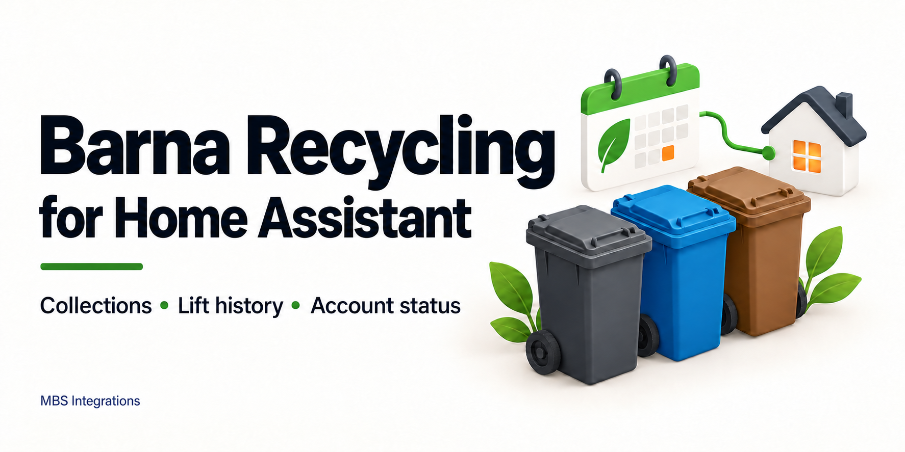
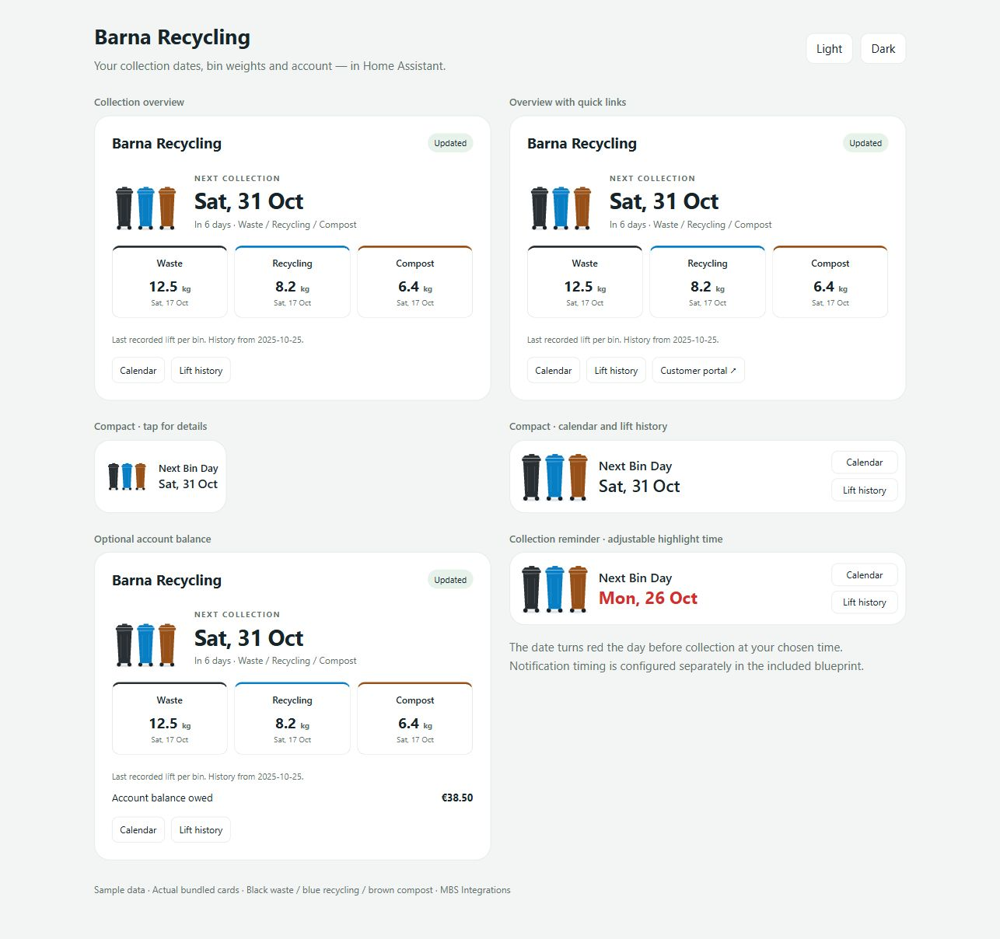
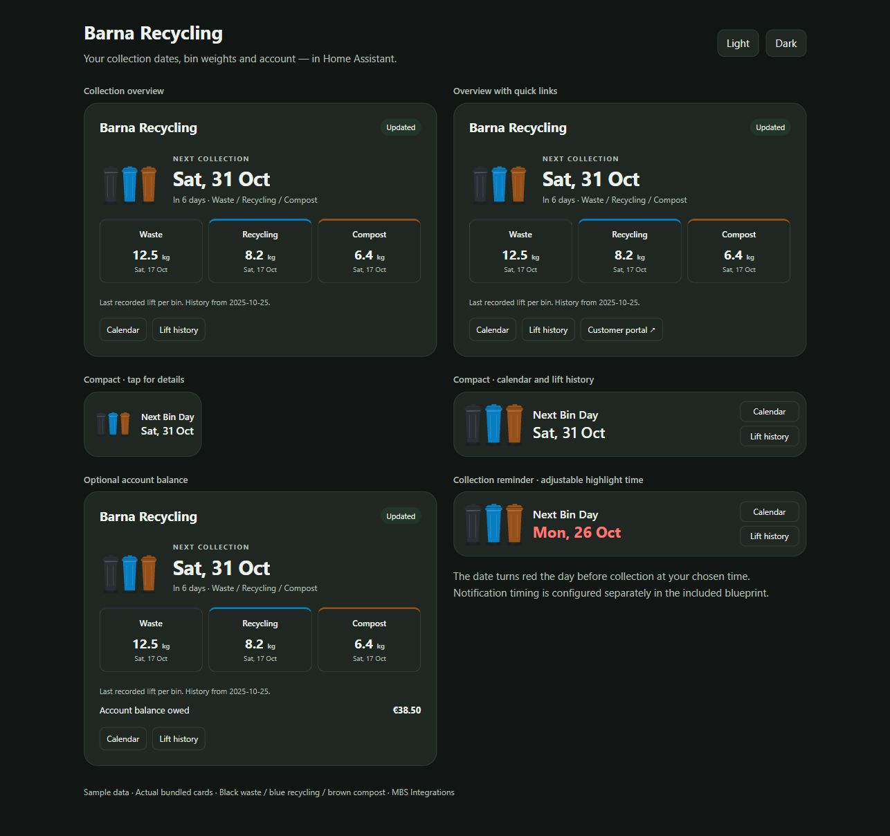
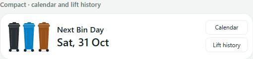
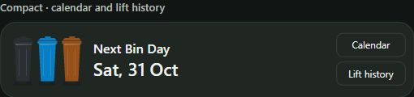
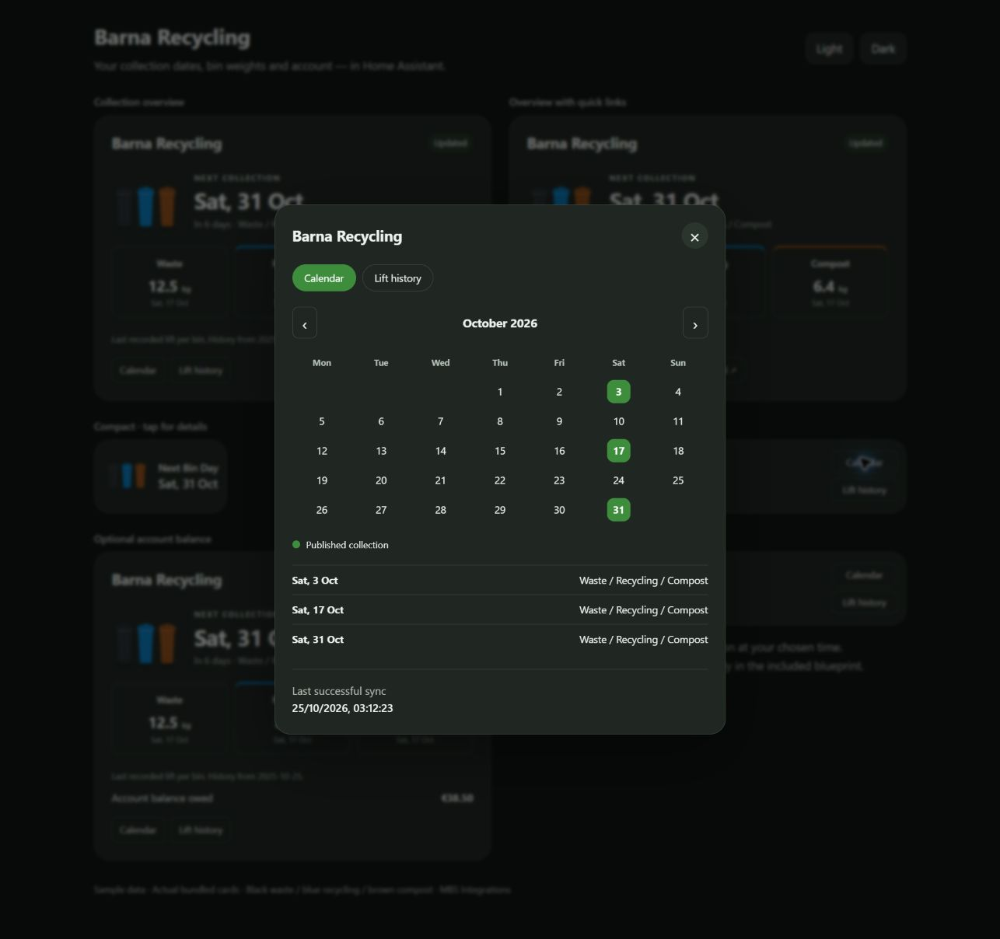
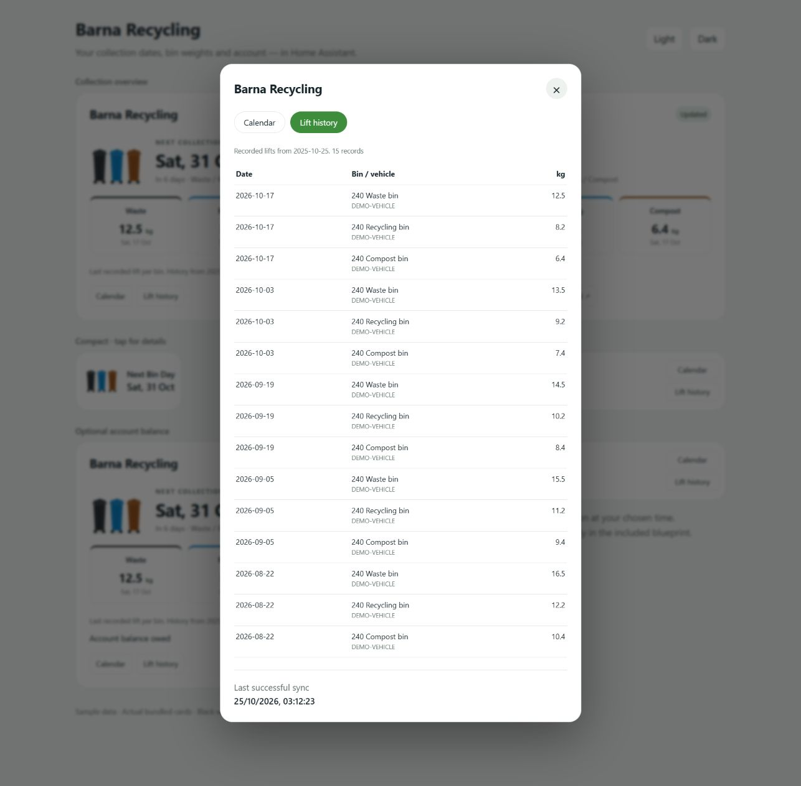
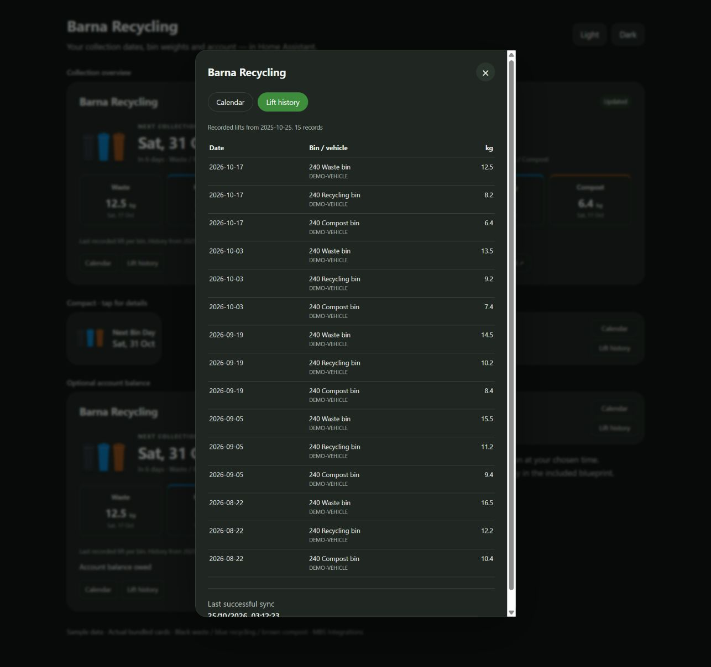

# Barna Recycling for Home Assistant



[](https://github.com/mbsintegrations/HomeAssistant-BarnaRecycling/actions/workflows/validate.yml)
[](https://github.com/hacs/default/pull/12619)
[](https://github.com/mbsintegrations/HomeAssistant-BarnaRecycling/releases)
[](LICENSE)

[](https://my.home-assistant.io/redirect/hacs_repository/?owner=mbsintegrations&repository=HomeAssistant-BarnaRecycling&category=integration)
[](#manual-installation)
[](https://my.home-assistant.io/redirect/config_flow_start/?domain=barna_recycling)

[](https://mbsintegrations.ie)
[](https://paypal.me/mwahl1973)

Bring your Barna collection calendar, recorded bin weights and account balance into Home Assistant. Includes four ready-made cards, calendar and lift-history popups, and a collection reminder blueprint.

**0.1.1 fixes portal parsing blocking Home Assistant's event loop.** Update through HACS and restart Home Assistant; your existing account, entities and cards are retained. [Release notes](CHANGELOG.md).

**Included in the default [HACS catalogue](https://github.com/hacs/default/pull/12619) since 3 November 2026.**

## Features

- **Published dates:** combined and separate waste, recycling and compost calendars. No guessed fortnightly schedule.
- **Recorded lifts:** dates, weights, vehicle references, bin descriptions, sizes and waste codes where supplied.
- **Account:** euro balance, debit/credit status and source notices as entities.
- **Four cards:** overview, overview with portal link, tiny compact, and compact with Calendar / Lift history buttons.
- **Light and dark themes:** black waste, blue recycling and brown compost bins. No additional dashboard dependencies.
- **Reminders:** adjustable notification time and days before collection. Card dates turn red at a separately adjustable time the day before.
- **Six-hour refresh:** ordinary account number/PIN login, private last-good cache, freshness indicators and native reauthentication.

## Card gallery

All screenshots use synthetic data and the actual bundled card code.

| Light | Dark |
| --- | --- |
|  |  |
|  |  |
|  |  |
|  |  |

See the [full screenshot gallery](docs/GALLERY.md), including phone layouts, the tiny card and red reminder date.

## Install

Requires **Home Assistant 2026.10.0 or newer**, a working Barna account and ordinary account number/PIN login. OTP-required accounts are not supported.

### Install with HACS

Barna Recycling is included in the default HACS catalogue.

[](https://my.home-assistant.io/redirect/hacs_repository/?owner=mbsintegrations&repository=HomeAssistant-BarnaRecycling&category=integration)

1. Install and configure [HACS](https://www.hacs.xyz/docs/use/) if needed.
2. Open **HACS** from the Home Assistant sidebar and search for **Barna Recycling**. If using a type filter, select **Integration**.
3. Open **Barna Recycling** and select **Download**. The current normal release is **0.1.1**; enabling beta versions is unnecessary.
4. **Restart Home Assistant**.
5. Continue with [Connect and add cards](#connect-and-add-cards).

The **Open Barna in HACS** button also opens the repository in your own Home Assistant installation. See the [HACS guide](docs/HACS.md).

#### Custom repository fallback

If Barna Recycling is not yet visible in your HACS search:

1. In **HACS**, open the top-right menu and choose **Custom repositories**.
2. Add `https://github.com/mbsintegrations/HomeAssistant-BarnaRecycling` with type **Integration**.
3. Find **Barna Recycling**, select **Download**, restart Home Assistant and [connect your account](#connect-and-add-cards).

Existing HACS installations continue receiving normal updates. Catalogue inclusion does not require reinstalling the integration, entering your PIN again or changing your cards.

### Manual installation

1. Download **`barna_recycling.zip`** and **`SHA256SUMS`** from the [latest release](https://github.com/mbsintegrations/HomeAssistant-BarnaRecycling/releases/latest).
2. Compare the ZIP's SHA-256 checksum with its entry in `SHA256SUMS`.
3. Extract the ZIP into the `custom_components` folder inside your Home Assistant configuration directory (usually `/config`). Create `custom_components` if needed.
4. Confirm this structure; avoid a second nested `barna_recycling` directory:

   ```text
   <config>/
   ├── configuration.yaml
   └── custom_components/
       └── barna_recycling/
           ├── __init__.py
           ├── manifest.json
           ├── config_flow.py
           ├── brand/
           └── frontend/
   ```

5. **Restart Home Assistant** and [connect your account](#connect-and-add-cards).

Alternatively, download the source for the chosen release and copy **only** `custom_components/barna_recycling` to that location. Keep the complete directory, including `brand` and `frontend`; the cards are bundled with the integration. Import the [notification blueprint](docs/REMINDERS.md) separately for either installation method.

### Connect and add cards

After installing the files through HACS or manually and restarting Home Assistant, the **Add integration to Home Assistant** button above opens the account setup dialog.

Go to **Settings → Devices & services → Add integration → Barna Recycling**. Enter your account number and PIN in the masked setup form. Do not put credentials in YAML. The integration validates unattended login and creates a Barna Recycling device.

Edit a dashboard, select **Add card**, and search **Barna Recycling**. Choose the **Collection summary** sensor. No Mushroom, card-mod or browser_mod dependency is needed.

## Documentation

- [Cards, YAML examples and resources](docs/CARDS.md)
- [Notification blueprint and date highlighting](docs/REMINDERS.md)
- [Entities, coverage and history action](docs/DATA.md)
- [Troubleshooting, updates and removal](docs/TROUBLESHOOTING.md)
- [Testing and limitations](docs/TESTING.md)
- [HACS](docs/HACS.md) · [Security](SECURITY.md) · [Contributing](CONTRIBUTING.md) · [Changelog](CHANGELOG.md)

## Coverage

The first release has been validated with **one real customer account and the combined three-bin vector PDF calendar format**. Other layouts need sanitized examples and parser support. Unsupported calendars are reported explicitly; the integration does not invent dates or guess ambiguous bin colours.

The requested last-12-month history may have a different source start date. Entities and popups display that coverage; recorded totals are **not lifetime totals**. Collections stop at the last published date until another calendar is available. Check source holiday changes before relying on a reminder.

Maintained by **MBS Integrations**, independently of Barna Recycling, with no affiliation or endorsement. The integration reads the customer portal; it cannot make payments, change contracts or request OTP. Barna names remain their owners' property. Source and original assets: [GPL-3.0-only](LICENSE).
